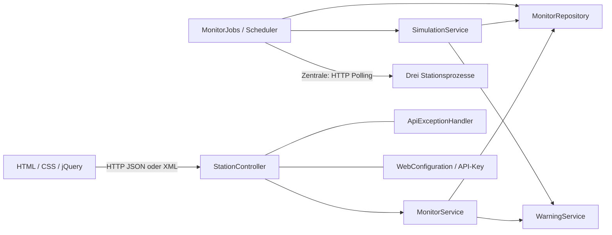
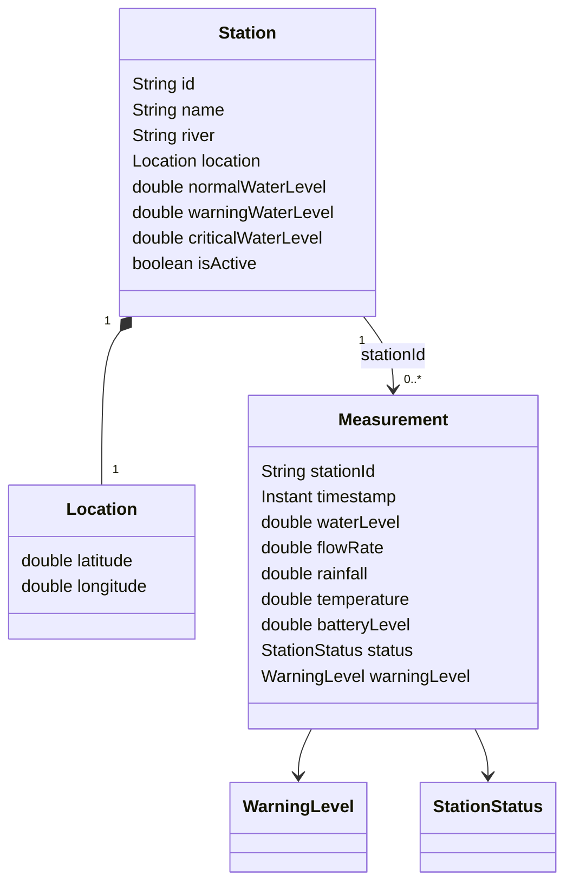

# Aufgabenanalyse und Architektur

## Umfang und Entscheidungen

Ausgangspunkt war ein leerer Projektordner. Die Implementierung deckt die verpflichtenden API-, Simulations-, Client- und Testanforderungen ab. Zusätzlich enthalten sind Stationsverwaltung, OpenAPI, Rollentrennung und der Mehrprozessbetrieb.

Die Aufgabenstellung erwähnt eine Statistik, legt aber keinen Pfad fest. Dafür wurde `GET /stations/{id}/statistics` ergänzt. „Aktuell“ wird als höchstens zwei Minuten alt definiert und ist konfigurierbar. Gibt es noch keine Messung, liefert latest 204; der Client und der Stationsfilter behandeln diesen Zustand als UNKNOWN.

## Schichten

Controller delegieren Fachlogik an Services. `MonitorRepository` verwendet synchronisierte Maps und liefert unveränderliche Snapshots. Schreibende Serviceoperationen und Simulationsschritte sperren dasselbe Repository, damit zum Beispiel PATCH und Simulation keinen veralteten Stationszustand gleichzeitig verwenden. Daten liegen ausschließlich im RAM. Die Retention verhindert unbegrenztes Speicherwachstum pro Station.

## Datenmodell

Alle Modelle sind Java Records. IDs sind auf 1–40 Buchstaben, Ziffern oder Bindestriche beschränkt. Namen/Flüsse: maximal 100 Zeichen, nicht leer. Koordinaten: Breitengrad −90…90, Längengrad −180…180. Schwellen: `0 <= normal < warning < critical`; NaN und Unendlich sind unzulässig. PATCH lässt die ID unverändert, lehnt unbekannte Felder und null ab und validiert den zusammengeführten Zustand.

## Simulationsregeln

Pro aktivierter, nicht ausgefallener Station entsteht pro Intervall eine Messung. Standardintervall: 10.000 ms; `fixedDelay` wartet nach Abschluss des Durchlaufs. Der vorherige Messwert bildet jeweils den Ausgangspunkt:

- Regen: vorheriger Regen plus Zufallswert aus [−1,8; 2,2), begrenzt auf 0…60 mm/h.
- Wasser: `max(0, vorheriger Pegel + Regen × 0,12 − (vorheriger Pegel − Normalpegel) × 0,015 + Rauschen)`; Rauschen aus [−1; 1) cm.
- Durchfluss: `Wasserstand × 2,4` m³/s. Das ist ein einfaches, monotones Demonstrationsmodell, keine hydrologische Kalibrierung.
- Temperatur: vorheriger Wert ±0,5 °C, begrenzt auf −20…40 °C.
- Akku: minus 0,02 Prozentpunkte je Messung, begrenzt auf 0…100 %.
- Akku unter 10 %: MAINTENANCE; bei 0 %: OFFLINE. Danach keine neuen Messungen.
- Wasser, Durchfluss, Regen und Temperatur auf eine Nachkommastelle, Akku auf zwei.

Die Parameter gelten pro Simulationsschritt; ein anderes Intervall verändert die Geschwindigkeit der simulierten Entwicklung. Demo-Historie: 36 Schritte pro Station mit festen Seeds 71–73. Der laufende Simulator verwendet einen eigenen Zufallsgenerator; Tests erhalten explizite Seeds.

Warnregel: unter Warnschwelle NORMAL, ab Warnschwelle WARNING, ab kritischer Schwelle CRITICAL. Fehlende, ungültige, zukünftige, veraltete, deaktivierte oder ausgefallene aktuelle Messungen ergeben UNKNOWN. MAINTENANCE-Messungen dürfen weiterhin eine fachliche Warnstufe besitzen. Historische Warnstufen spiegeln die Berechnung bei der Erfassung wider, latest wird anhand des jetzigen Stationszustands bewertet.

## Statistik und Zeiträume

Grenzen inklusive, Reihenfolge neueste zuerst. Statistik nutzt alle noch gespeicherten Treffer, unabhängig vom `limit` des Historienendpunkts. Leer: count und Summen 0, Min/Max/Mittelwerte null. Warnzähler zählen WARNING bzw. CRITICAL getrennt. `totalRainfall` summiert die gemeldeten Stundenwerte, wie in der Aufgabe gefordert. Da diese überlappende Zeitfenster darstellen, ist die Summe ausdrücklich **keine** physikalische Niederschlagsmenge in mm.

## Fehler und Formate

Zentrale Fehlerstruktur: timestamp, status, error, message, path. Fachfehler werden in den HTTP-Status übersetzt; ungültige Bodies/Parametertypen ergeben 400. JSON/XML-Konverter übernehmen die Serialisierung. 406 erhält JSON als expliziten Fallback. Keine Stacktraces im Response, unerwartete Fehler werden serverseitig protokolliert. Nicht unterstützte HTTP-Methoden liefern 405 und Allow.

## Reflexion

- XML-Listen brauchen benannte Wurzel- und Kindelemente. Explizite Response-Records und Tests sichern die Struktur ab.
- Zeitabhängige Warnungen und Zufall würden Tests instabil machen. Uhr, Zufall und Scheduler lassen sich getrennt kontrollieren.
- Das Aufgabenfeld `rainfall` beschreibt eine Stundenrate. Eine naive Summenanzeige als „Regenmenge in mm“ wäre fachlich irreführend; die UI benennt die Summe entsprechend.
- PowerShell zerlegte zunächst den unquotierten Maven-Parameter mit Punkten. Der lokale Build verwendet deshalb quotierte `-D...`-Argumente; für Nutzer stehen die üblichen Wrapper-Befehle bereit.
- Der Mehrprozessbetrieb benötigt ein klares Eigentum an Stationsdaten: verwaltet wird direkt an den Stationen, die Zentrale aggregiert. Speicherpersistenz, dynamische Quellenregistrierung und verteilte Transaktionen sind nicht Bestandteil dieser Demo.
